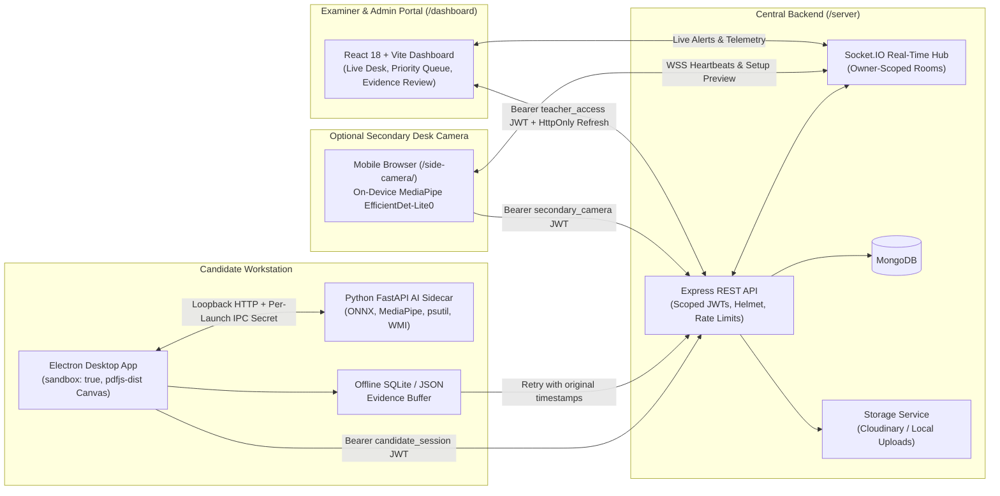

# IntegrityFlow

**AI-assisted, multi-angle exam proctoring and assessment integrity platform.**

IntegrityFlow pairs a locked-down Electron + Python candidate desktop application, an optional browser-based secondary desk camera (on-device MediaPipe AI), an Express + Socket.IO + MongoDB backend, and a real-time React examiner dashboard. Every automated signal is captured with verifiable evidence so human examiners—not opaque black-box scripts—make final integrity decisions.


---

## System Architecture



---

## Key Features

### 1. Multi-Angle AI Proctoring
- **Front-Camera Computer Vision (`candidate-app/ai-module`):**
  - Head-pose tracking (lateral yaw `head_turn_away`, desk gaze, upward pitch), multi-face / missing-face detection, and unauthorized object detection (`cell_phone`, `unauthorized_object`) via CPU-bounded ONNX Runtime & MediaPipe.
  - Photometric lens occlusion and dark-feed defense (`camera_occluded_or_dark`).
  - Automatic compressed evidence capture (<200 KB JPEG) attached to every violation event.
- **Optional Secondary Phone Desk Camera ([SIDE_CAMERA.md](SIDE_CAMERA.md)):**
  - Zero-install mobile web page at `/side-camera/` paired via single-use 5-minute QR tokens—no WebRTC or direct phone-to-laptop LAN connection required.
  - Guided 3-second placement check (head/upper body, desk workstation, lighting, tilt steadiness) with transient setup preview on the laptop that stops immediately upon verification.
  - Captures a **Clean Desk Baseline** photo for examiner review and runs on-device EfficientDet-Lite0 desk checks (~2.5–3s cadence) for extra phones, unauthorized books/screens, second persons, candidate absence, phone movement, lens obstruction (dark or flat bright cover), and disconnects.
  - Examiners can trigger an on-demand **Capture Desk Check** snapshot during an active exam.
- **Dual-Mode Assessment Support:**
  - **Remote Online Mode:** Full webcam vision, optional secondary phone camera, periodic identity photo checkpoints, process whitelist, USB guard, and display enforcement.
  - **On-Campus Physical Lab Mode:** Bypasses webcam/mic checks for lab workstations while enforcing shell lockdown, process whitelisting, USB removable-storage blocking, and pre-existing file checks.

### 2. Locked-Down Candidate Desktop Workspace (`candidate-app/`)
- **Hardened Electron Shell:** `sandbox: true`, `contextIsolation: true`, `nodeIntegration: false`, removed application menu, strict local-renderer permission allowlist, blocked popup/external navigation, blocked DevTools/Reload/Print/Save/mid-exam close shortcuts, and server-confirmed `finish-exam` gating so monitoring cannot be stopped while a session is active.
- **Anti-Leak Paper Viewer & Clipboard Lockdown:**
  - Renders PDF question papers to high-DPI `<canvas>` elements via `pdfjs-dist` (legacy build for Electron 29 compatibility, `isEvalSupported: false`) with a read-only zoom toolbar—eliminating Chromium's built-in Download/Print toolbar.
  - Converts DOCX papers via Mammoth through a DOM sanitizer (`sanitizeDocxHtml`) and overlays dynamic per-candidate diagonal watermarks.
  - Flushes the OS clipboard on exam start and blocks copy/cut/paste/context-menu events.
- **Process Whitelist, USB & Pre-Existing File Guards:**
  - Strict exam-mode process allowlist (excludes `taskmgr.exe`, external `python.exe`/`node.exe`/`electron.exe`, `phoneexperiencehost.exe`, WSL/Docker shells) while protecting IntegrityFlow's own process tree by exact PID and enforcing `SAFETY_LIST` on `/kill-app`.
  - Pre-existing document guard flags files modified prior to exam start in permitted apps or answer uploads.
  - Multi-display hardware detection (`screen` API + Windows WMI) and removable USB drive blocking.
- **Offline Resilience & Sidecar Recovery:**
  - Crash-proof disk-backed violation buffer (SQLite / atomic JSON) preserves original event timestamps and retries automatically across network outages and post-exam completion without altering live risk scores until reviewed.
  - Unexpected Python sidecar exits during an active exam immediately alert the examiner (`camera_issue`, severity 4) and attempt bounded automatic recovery.

### 3. Examiner & Admin Command Dashboard (`dashboard/`)
- **Live Monitoring Desk:** Warm-stone Light mode and Obsidian Graphite Dark mode, collapsible Fluent-inspired sidebar, active exam context switcher, Focus Mode, 4 teacher-focused KPI cards, and an **Active Exam Overview** bar (Waiting Lobby paper release, `+5m` / `+10m` live time extensions, End Exam).
- **Human-in-the-Loop Triage:**
  - Cross-student **Priority Queue**, **Real-Time Alert Feed**, filterable **Candidate Grid**, and a 3-tab **Evidence Review** drawer (**Final Submission**, **Evidence Timeline**, **Camera & Identity** with side-camera desk baseline & on-demand desk check).
  - Exponential severity-decay risk scoring engine (15-minute half-life) with explicit examiner confirmation/dismissal workflow.
- **In-Exam Communication & Lifecycle:** Exam-scoped candidate inquiries, examiner replies, broadcast announcements, and automatic exam expiry archiving.
- **Examiner Auth & Administration:** Email/password auth with email verification, single-use password reset, **Google Identity Services (Google Sign-In)** with safe account linking & role preservation, plus an Admin Console for storage asset management, audit logs, and user administration.

### 4. Defense-in-Depth Security Architecture
- **Strictly Scoped JWTs:** Separate token scopes for `teacher_access` (15m API), read-only `media_read` (for `/uploads` media URLs—rejected by API endpoints), `candidate_session` (24h, bound to candidate `sessionId`), and `secondary_camera` (4h, bound to `sessionId` + rotating `jti`).
- **Session & Tenant Isolation:** Candidates can only access their own session, paper, chat, and submissions; teachers can only access exams, sessions, evidence, and Socket.IO broadcasts they own; admins retain global oversight.
- **Upload & Query Hardening:** Submission upload allowlist/denylist blocking `.html`/`.svg`/`.js`/executables, forced `Content-Disposition: attachment` + `X-Content-Type-Options: nosniff` + sandbox CSP, escaped regex queries across all routes (preventing wildcard injection), CORS credentials restricted strictly to `DASHBOARD_URL`, unified single-flight 401 token refresh lock, per-launch Electron↔Python IPC secret, and `fs.realpathSync` + `path.relative` evidence path containment.

---

## Repository Structure

```text
IntegrityFlow/
├── server/                     # Node.js + Express + Socket.IO + MongoDB backend
│   ├── src/
│   │   ├── middleware/         # Teacher auth, scoped candidate/side-camera auth, exam ownership RBAC
│   │   ├── models/             # Teacher, Exam, Session, Violation, Submission, Message, AuditLog
│   │   ├── routes/             # auth, exams, examPaper, sessions, violations, submissions, messages, pairing, admin
│   │   ├── scoring/            # Dynamic exponential decay severity engine
│   │   ├── services/           # Secondary camera watchdog/relay, Cloudinary/local storage, mail
│   │   ├── sockets/            # Authenticated, exam-scoped Socket.IO server
│   │   └── utils/              # Google RS256 JWKS verifier, scoped tokens, regex escaping, lifecycle
│   ├── public/side-camera/     # Self-hosted phone camera page + MediaPipe WASM/model
│   └── checks/                 # Isolated HTTP/Socket/security regression suites
├── dashboard/                  # React 18 + Vite examiner & admin web portal
│   └── src/
│       ├── components/         # ExamManager, CandidateGrid, PriorityQueue, AlertFeed, EvidenceViewer, AdminDashboard, GoogleSignInButton
│       ├── context/            # AuthContext (in-memory tokens + single-flight refresh)
│       ├── pages/              # Dashboard, Login, Signup, ForgotPassword, ResetPassword, VerifyEmail
│       └── services/           # Axios client & media-scoped assetUrl helper
├── candidate-app/              # Electron 29 desktop app + local Python AI sidecar
│   ├── electron/               # Main process, preload bridge, windowSecurity, pythonBridge, violationBuffer/Forwarder
│   ├── renderer/               # Login, consent, identity, self-check, examScreen (esbuild bundled)
│   └── ai-module/              # FastAPI local IPC server, AIMonitor, WhitelistEnforcer, USBMonitor, VoiceMonitor
├── CONTRACT.md                 # Shared API & event contract
├── SIDE_CAMERA.md              # Secondary phone camera architecture, HTTPS tunnel setup & acceptance checklist
└── TODO.md                     # Remaining milestones & real-device verification items
```

---

## Prerequisites

- **Node.js** 20+ (tested on Node 24)
- **Python** 3.10–3.12 (for `candidate-app/ai-module` virtual environment)
- **MongoDB** (local instance or MongoDB Atlas URI)
- **Optional:** Cloudinary account (falls back to local `server/uploads/`), SMTP credentials (falls back to Ethereal preview), Google Cloud OAuth 2.0 Web Client ID (for Google Sign-In), and `cloudflared` or `ngrok` HTTPS tunnel (for real-phone secondary camera testing).

---

## Environment Configuration

### 1. Backend (`server/.env`)
```dotenv
MONGODB_URI=mongodb://localhost:27017/integrityflow
SERVER_PORT=5000
DASHBOARD_URL=http://localhost:5173

# Required cryptographic secrets (use >= 32 random chars each)
JWT_SECRET=<random-secret-32-plus-chars>
RESET_TOKEN_SECRET=<random-secret-32-plus-chars>
SESSION_TOKEN_SECRET=<random-secret-32-plus-chars>

# Optional: Google Sign-In for examiners (Dashboard auto-discovers via /auth/providers)
GOOGLE_CLIENT_ID=<your-web-client-id>.apps.googleusercontent.com

# Optional: Public HTTPS backend origin required for Secondary Phone Camera QR pairing
PUBLIC_URL=https://your-backend-tunnel.example.com

# Optional: Email verification & Cloudinary storage
REQUIRE_EMAIL_VERIFICATION=false
# CLOUDINARY_CLOUD_NAME=...
# CLOUDINARY_API_KEY=...
# CLOUDINARY_API_SECRET=...
```

Generate strong random secrets locally with:
```bash
node -e "console.log(require('crypto').randomBytes(32).toString('hex'))"
```

### 2. Candidate App (`candidate-app/.env`)
```dotenv
SERVER_URL=http://localhost:5000
# Set to your HTTPS PUBLIC_URL when testing the secondary phone camera
APP_MODE=exam
# Use APP_MODE=dev during local development to keep DevTools & dev whitelist enabled
```

### 3. Dashboard (`dashboard/.env`, optional)
```dotenv
VITE_API_URL=http://localhost:5000
```

---

## Setup & Running Locally

Start the **Server** and **Dashboard** before launching the **Candidate App**.

### 1. Backend Server
```bash
cd server
npm install
npm run dev
```

### 2. Examiner Dashboard
```bash
cd dashboard
npm install
npm run dev
```
Open `http://localhost:5173` in your browser.

### 3. Candidate App (Python Sidecar + Electron)
```bash
# Set up Python virtual environment for the AI sidecar
cd candidate-app/ai-module
python -m venv .venv
.venv\Scripts\activate          # Windows (or: source .venv/bin/activate on macOS/Linux)
pip install -r requirements.txt

# Install & launch Electron app (automatically builds renderer bundles via prestart)
cd ../electron
npm install
npm start
```

---

## Automated Verification & Security Checks

All security, isolation, late-evidence, side-camera, and Electron lockdown invariants have automated regression scripts that run against isolated doubles without touching production databases:

| Suite | Command | Coverage |
|---|---|---|
| Candidate Session Auth | `npm --prefix server run check:candidate-auth` | Scoped Bearer JWTs across `/violation`, `/submissions`, `/sessions/:id/status`, `/camera-verification`, `/exam/:id/paper`, `/messages` |
| Server Security Hardening | `npm --prefix server run check:security` | Legacy `/exam` scoping, submission XSS `fileFilter` + attachment/sandbox headers, regex escaping, single-use reset JWTs, `media_read` vs `teacher_access` scope isolation |
| Google Sign-In (RS256) | `npm --prefix server run check:google-auth` | Ephemeral RS256 JWKS verification, safe account linking, role preservation, sub-hijack blocking, unverified-email rejection |
| Late Evidence & Offline Buffer | `npm --prefix server run check:late-evidence` | Post-completion multipart retries, idempotency, path containment, review-gated scoring |
| Secondary Phone Camera | `npm --prefix server run check:side-camera` | QR pairing lifecycle, 4h phone JWTs, preview privacy/throttling, placement + Part-2 desk AI rules, watchdog grace/reconnect |
| Tenant & Socket Isolation | `npm --prefix server run check:isolation` | Per-teacher exam/session/violation isolation and admin scoping |
| Electron Window & IPC Security | `npm --prefix candidate-app/electron run check:security` | `sandbox: true`, permission allowlist, shortcut blocking, server-confirmed `finish-exam`, `pdfjs-dist` canvas rendering, whitelist hardening, local IPC secret, path containment |
| Consent & Identity Flow | `npm --prefix candidate-app/electron run check:consent` | Explicit consent enforcement before identity registration |
| Dashboard Production Build | `npm --prefix dashboard run build` | Vite production bundle verification |

---

## Documentation

- [CONTRACT.md](CONTRACT.md) — API endpoints, payload contracts, and Socket.IO event schemas.
- [SIDE_CAMERA.md](SIDE_CAMERA.md) — Secondary phone camera privacy architecture, HTTPS tunnel setup, and physical-device acceptance checklist.
- [TODO.md](TODO.md) — Completed hardening milestones and remaining items.

---

## Team

- **Rao Umair Ahmed**
- **Muhammad Usman**
- **Abubakar**
